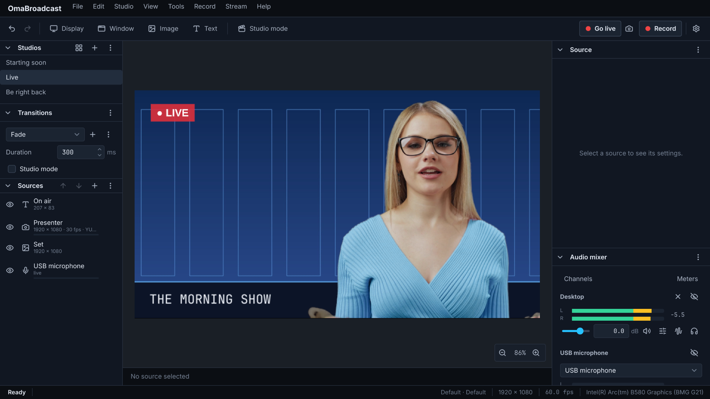

# OmaBroadcast

Record and stream live video on [Omarchy](https://omarchy.org). Bring in your
screen, windows, cameras and phone, arrange them into studios, and switch
between them while you record, go live, or both at once.



**First test release · Omarchy x86_64.** Expect some rough edges. Which encoders
you can use depends on your graphics card and its driver; the app only offers
the ones that work on your machine.

## Install

You need one file: the package whose name ends in **`x86_64.pkg.tar.zst`**, on
the newest [release](https://github.com/28allday/omabroadcast/releases/latest).

**The quick way:** the release page starts with a single command. Open a
terminal (**Super+Enter** on Omarchy), paste it, press Enter and give your
password. It downloads the package and installs it in one go.

**Or by hand:**

1. On the [newest release](https://github.com/28allday/omabroadcast/releases/latest),
   under **Assets**, download the file ending in `x86_64.pkg.tar.zst`. The other
   files (the source and the checksums) are not needed to install.
2. Open a terminal and install it:

   ```sh
   sudo pacman -U ~/Downloads/omabroadcast-*.pkg.tar.zst
   ```

3. Enter your password when asked and confirm the packages to install.

Then open **OmaBroadcast** from your application launcher (**Super+Space** on
Omarchy).

Everything it needs comes with the package, including its own copy of FFmpeg.
You do not need to compile anything. If your system has not been updated for a
while, run `sudo pacman -Syu` first.

## Getting started

Each start opens with a small window showing the version number: press **OK**.
The first time, OmaBroadcast then asks what you are making: streaming,
recording, tutorials, recording for editing, game replays, video calls or light
recording. It tests the encoders on your machine, then shows you what it will
set up. You can run this again from **Tools → Set up for…**.

The window has three parts:

- **Left** — your studios, the transition between them, and the sources in the
  current studio.
- **Centre** — the picture. This is exactly what gets recorded or streamed.
- **Right** — the settings of the selected source, and the audio mixer.

To make your first recording:

1. Click **Display** to record your whole screen, or **Window** for one app. Your
   desktop asks which one to share.
2. Drag a corner of the picture to make it smaller, or drag it to move it.
3. Click **+** in Sources and choose your microphone under **Microphone or audio
   input**, **Desktop sound** or both. Nothing records sound until you do. Say
   something and watch the bars in the Audio mixer: green is good, yellow is loud, red
   is too loud.
4. Press **Record** or **Ctrl+R**. A timer shows how long it has run.
5. Press **Stop** when you are done. The file goes in `~/Videos/OmaBroadcast`.

Press **F1** for the built-in guide, which can point at the real controls as you
go, or rest the pointer on any control to see what it does. The full
[user guide](MANUAL.md) is also available without opening the app.

## Build your studios

Each studio is a shot. Fill it with screens, windows, cameras, capture cards,
your phone, video files, web pages, pictures, slideshows, OmaShow presentations and text, then switch
between studios with a cut, a fade or another transition. Studio mode lets you
change one studio while another stays live, ready for you to take it.

A phone source makes its own passphrase, so only a phone you have set up can send
it a picture. Select it to see, on the right, what to type into the phone app.

Right-click a source and choose **Filters…** to clean up its picture, with green
screen, background removal without a green screen, colour wheels and scopes.

## Record and go live

Record to MKV, MP4 or MOV, with APV for recordings you will edit and each
sound on its own track. MKV is the default because the file still plays if the
recording is cut off by a crash or power cut. The replay buffer keeps the last
few seconds until you decide to save them.

Add the places you go live to in **Settings → Streaming**: Twitch, YouTube,
Facebook Live, Restream or your own server, several at once. Stream keys are kept
in your desktop keyring and never shown again.

The virtual camera offers your picture to browsers and video-call apps.

## Read from a script

**Tools → Prompter** opens your script in a window of its own, a text or Markdown
file scrolling past a reading line. Drag it beside the camera or over the picture,
and resize it to suit. It is never part of the picture, so recordings and streams
cannot show it. On Hyprland it is also kept out of screen captures, where it shows
as a black box, so keep it off any screen you are capturing.

## Check a recording

**Tools → Play last recording** opens the last recording in a window of its own, to check
it before you send it on. It has a sound meter for each channel with the loudest peak,
the file's details, and shuttle keys: **J**, **K** and **L** go back, stop and forward
(press again to go faster), and the arrow keys move a frame at a time.

## Mix the sound

You choose every picture and every sound in one place, the **+** in Sources. Adding a
camera or capture card brings its picture alone; its own microphone is listed under
**Microphone or audio input** with the others. The Audio mixer shows only the sound you
have added. **X** on a Desktop, Microphone or Sound for every studio strip removes it.
Any other sound is a source: right-click it in Sources and choose **Remove**. **Sound
for every studio…** keeps a sound in all your studios. **Set up for…** adds the
microphone you choose there and, for streaming, recording for editing, game replays and
video calls, the desktop's sound too. It tells you before you press **Create**.

Every sound gets its own strip, with its level and mute. Press the waveform button
on a strip for noise suppression, a compressor, a gate, EQ and more. To capture
one app's sound, use **Application audio** in the same **+** menu.

## Control it from elsewhere

Set your own keys in **Settings → Hotkeys**, or run any action from a terminal or
your window manager:

```sh
omabroadcast ctl record.toggle            # start or stop recording
omabroadcast ctl studio.show "Close up"   # switch studio
omabroadcast ctl list                     # every action it knows
```

On Omarchy, OmaBroadcast puts its own icon in the bar the first time it opens. Click
it to show or hide the window, or to open the app when it is closed. Right-click it
to start and stop recording and streaming. It turns red with a timer while you are
recording or live. Turn it off in **Settings → General**, or move or remove it as with any other
bar icon.

**Tools → Remote control…** connects Stream Deck and other stream controllers,
and **Tools → Scripts…** runs your own JavaScript. Remote control stays off until
you switch it on.

## Your recordings and settings

| Where | What |
| --- | --- |
| `~/Videos/OmaBroadcast/` | Your recordings, unless you choose another folder in **Settings → Recording** |
| `~/.config/omabroadcast/` | Your settings, profiles and studios |
| Your desktop keyring | Your stream keys |

## Useful keys

| Key | Action |
| --- | --- |
| `F1` | The guide |
| `Ctrl+R` | Start or stop recording |
| `Ctrl+Shift+R` | Save a replay |
| `Ctrl+Shift+D` / `Ctrl+Shift+W` | Add a display / add a window |
| `Ctrl+,` | Settings |
| `?` | Every hotkey |
| `Ctrl+Q` | Quit (asks first while recording or streaming) |

## If something goes wrong

- **Help → Log** shows what OmaBroadcast has reported, ready to copy into a bug
  report.
- After a crash, it says so the next time it opens and offers **safe mode**, which
  starts with your captures and outputs off so you can find the cause.
- **Help → Repair…** checks your studios and profiles, and sets aside any that are
  damaged.

## What you need

- Omarchy on an x86_64 computer. Other Wayland desktops with a screen-sharing
  portal and PipeWire should work too, though a few things, such as drawing a
  screen region, are made for Hyprland.
- A graphics card with a Vulkan driver. Without one OmaBroadcast still runs, on
  the processor: a fast desktop processor holds an ordinary 1080p studio at 60
  frames a second, but the heavier filters, such as Remove background (AI), need a
  graphics card; without one, a source using Remove background (AI) is hidden rather
  than shown with its background. Built-in graphics and entry-level laptop cards manage 1080p at 60
  frames a second. For 4K at 60 with the AI filters, you want a mid-range desktop
  card or better.
- For presentations, [OmaShow](https://github.com/28allday/omashow). Version 0.2.4 or
  newer steps through a slide a click at a time; older versions show each slide whole.

## Updating or removing

To update, close OmaBroadcast, download the newer package and install it the same
way.

To remove it, take its icon out of the Omarchy bar, then the app:

```sh
omarchy plugin remove nosignal.omabroadcast
sudo pacman -R omabroadcast
```

Your recordings and settings stay where they are.

## Feedback

Please [report a problem](https://github.com/28allday/omabroadcast/issues) with
your OmaBroadcast version, your graphics card and the steps that reproduce it.
**Help → Log** has the details worth including.

## Licence

OmaBroadcast's own code is free software under the [MIT licence](LICENSE). The
package also carries FFmpeg and other components under their own licences, which
makes the package as a whole GPL v3. [Third-party notices](THIRD_PARTY.md) describe
them and what they were built from, and every release has the complete source
beside its package.

[Build from source](BUILDING.md).

Copyright © 2026 Gavin Nugent.
